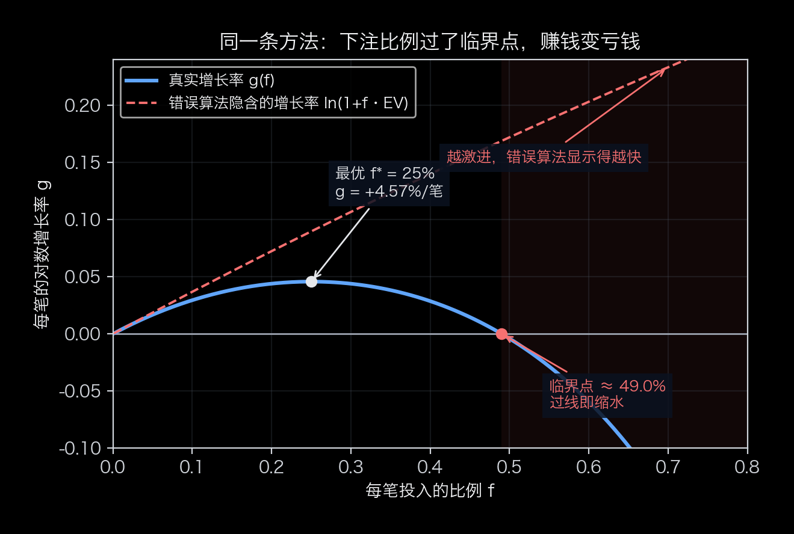
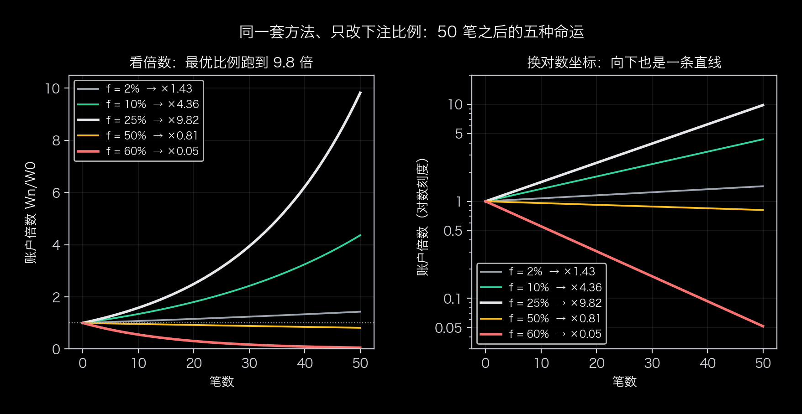
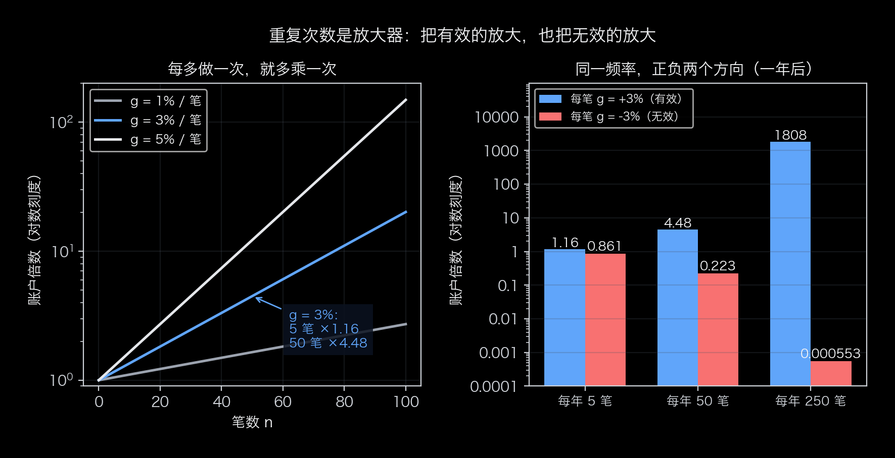

# 押多少、做多少次：复利里反直觉的两个开关

上一篇把 $g$ 的符号验了出来。可 $g$ 还捏在两个变量手里：每笔押本金的多少比例（$f$）、总共做多少次（$n$）——一个管生死，一个管速度，而且两个都反直觉：**方法真的赚钱，押多了照样亏；“多做”既是放大器，也是陷阱。**

## 关键点二：每笔不贪多

先给一个反直觉的事实：**就算方法真的能赚钱，下注太多，账户也会越做越亏。**

拿一组公开示例参数算一遍。假设有一套方法：

- 胜率 55%，赢的时候赚 1.5 个风险单位、输的时候亏 1 个风险单位；
- 平均每笔 = 0.55 × 1.5 − 0.45 × 1 = **+0.375 个风险单位**，是正的（就是上一篇那套）。

再假设一个习惯：每做一笔，拿**当前本金的固定比例**去冒险——这就是“固定比例下注”。同一套方法，只改这个比例，做 50 笔之后：

| 每笔冒险 | 真实每笔增长 $g$ | 50 笔后（真实） | 错误算法说（每笔） |
|---|---|---|---|
| 2% | +0.72% | ×1.43（慢，但在涨） | +0.75% |
| 10% | +2.95% | ×4.36 | +3.75% |
| 25% | **+4.57%** | **×9.82（数学最优）** | +9.38% |
| 50% | **−0.41%** | **×0.81（反而缩水）** | +18.75% |
| 60% | −5.93% | ×0.05（快速缩水） | +22.50% |

方法没变、胜率也没变，只是下注比例过了头——**一套平均每笔赚钱的方法，做出来的却是一个不断亏钱的账户。**

为什么？两个原因。

**第一，复利是乘出来的，盈亏不对称。** 亏掉一半，要翻倍才能回本；先亏一半、再赚一半，账户只剩 0.75 倍。赚和亏轮流出现时，“亏”对“赚”的拖累比直觉大得多——同样的平均收益，波动越大，账户实际滚得越慢。这个拖累有确切的名字和公式，见下面的数学版。

**第二，有一个顺手的错误算法，会专门骗你往大里下。** 它会这样算：平均每笔赚 0.375 个单位，那每笔下注 60%，每笔不就赚 22.5%？——这个算法漏掉了波动，会算出一条永远向上的直线，把“越激进”显示成“越快”。真实情况是：60% 那一行，账户在缩水。更刺眼的对比如下——**同一个 60%，错误算法说 50 笔后是 ×25,516，真实是 ×0.05，差了约五十万倍。**

### 数学版（可跳过）

完整推导（单笔递推、连乘、取对数、大数定律、泰勒展开）在《复利的三个关键点：完整推导与数字复核》里，这里只留三个结果。

**一、真实增长率是 $g=\mathbb{E}[\ln(1+fR)]$，不是 $f\cdot\mathrm{EV}$。** 把精确式 $W_n=W_0\prod(1+fR_i)$ 取对数再除以 $n$，大数定律给出前者；$W_0(1+f\,\mathrm{EV})^n$ 是另一回事，它永远向上，是错的。

**二、差在 Jensen 不等式。** 对数函数是凹的，所以

$$\mathbb{E}\big[\ln(1+fR)\big]\ \le\ \ln(1+f\,\mathrm{EV})$$

等号只在没有波动时成立。取展开 $\ln(1+x)\approx x-\frac{x^2}{2}$，差距分成两项：

$$g\ \approx\ \underbrace{f\cdot \mathrm{EV}}_{\text{算术增长}}\ -\ \underbrace{\frac{f^2}{2}\,\mathbb{E}[R^2]}_{\text{方差惩罚}}$$

第一项永远向上，第二项是负的、还随 $f$ 平方增长——**“押得越猛赚得越快”这个直觉，只看到了第一项**。这个差距叫**波动率拖累**。

**三、最优比例与临界点。** 令导数为 0，得 $f^*\approx\mathrm{EV}/\mathbb{E}[R^2]$（近似）；每笔只有“赢、输”两种结果时有不作近似的精确解（凯利公式）：

$$f^*=\frac{pR_W-q\,|R_L|}{R_W\,|R_L|}=\frac{p}{|R_L|}-\frac{q}{R_W}$$

代入示例：$f^*=0.55-0.45/1.5=25\%$，与表中一致。临界点由 $g=0$ 给出，二阶近似下恰是最优值的两倍（$f_c\approx2f^*$），示例参数下精确解是 $f_c\approx49.0\%$——**超过它，同样的方法、同样的胜率，账户长期必然缩水**，这就是表里 50%、60% 两行变负的原因。（这个近似有适用边界——实算就能找出反例，别把它当无条件红线。）

*图 3：蓝线是真实的每笔增长率 $g(f)$——先升后降，在 25% 见顶、约 49% 处穿过零线；红线虚线是错误算法隐含的增长率——**它只会一路向上**。两张脸差在“方差惩罚”这一项上。*

*图 4：同一套方法，只改下注比例，50 笔之后的五种结局：2% 慢涨（×1.43）、10% 中速（×4.36）、25% 最快（×9.82）、50% 微跌（×0.81）、60% 快跌（×0.05）。右图换对数坐标后，曲线都是直线——**斜率就是每笔增长率 $g$；向下那条，斜率是负的。***

### 那到底下多少算“不贪”

**先分清“固定比例”和“固定金额”，这是复利与工资的分界线。** 固定金额下注，每笔赚的钱是常数 $c$：$W_n=W_0+n\,c$，做一万次也还是一条直线。固定比例下注，每笔赚的钱跟着本金一起长大：$W_n=W_0\prod(1+fR_i)$，本金越大，同样一笔赚的越多，于是才有指数。上班拿工资属于前者——一天卖一天的时间，单价不随你的资产放大。这不是说工资不好（它是现金流的底座），而是说**它不在这套复利逻辑里**：想让钱滚起来，得先有一个“收益跟着本金一起放大”的载体。弄清了这一层，再谈比例选多大。**因此，“② 每笔不贪多”的准确说法是“每笔只押本金的固定比例，且比例不超过最优值”——固定工资不满足这一条，它只是“每笔金额固定”。**

数学上有一个最优比例（这套参数里是 25%），但**现实中没人用满**——因为你估计的 55%、1.5 这些数字本身有误差，误差会把“最优”变成“灾难”：$f^*$ 附近曲线是平的，$f$ 稍微过一点，$g$ 就开始往下走，参数估错的代价不对称。常见做法是**分数凯利**：只用最优值的一部分，

$$f=\lambda f^*,\qquad \lambda\in\left[\tfrac14,\ \tfrac12\right]$$

先保证活得久，再谈快。

**一句话：下注的上限不是胆量，是数学。赚得稳（低方差）比赚得猛（高均值）更重要。**

## 关键点三：把有效的事重复够多次

这条最简单，也最容易被误解。

先记住一个反常识的结论：**复利靠“做了多少次”，不靠“等了多久”。** 每做一次，账户才乘以一个数；空仓的时候什么都没发生——不赚不亏，也不“复利”。同样是 100 次，一年做完和五年做完，结果完全一样（前提是每笔的统计特征不变）。“长期主义”如果只剩下“等”，那它什么都没做。

数学上，时间只通过一个渠道进来：一段时间 $t$ 内能做多少次，取决于频率 $\nu$（比如每年做多少笔）：

$$n=\nu\cdot t\qquad\Longrightarrow\qquad \frac{W(t)}{W_0}\ \approx\ e^{\,n\,g}=e^{\,(\nu g)\,t}$$

（这里的“≈”同样要求 $n$ 足够大：时间越长、频率越高，$n$ 才越攒得够——这也正是时间只能通过“多做”起作用的原因。）

也就是说：**年化对数增长率 = 频率 × 每笔增长率**。复利是被“做了一次又一次”这个事件驱动的，日历时间本身不产生任何东西。

再看次数的威力：假设每笔的增长率 $g=3\%$（示意数字），做 5 次是 ×1.16，做 50 次是 ×4.48——每上一个台阶，结果都按乘法拉开；而频率把这件事再放大：每笔 3%、一年做 250 笔，一年后是 ×1808（仍是示意数字）——**这也是为什么“多做”既有吸引力，又危险。**

*图 5：左图——同样的每笔增长率，重复次数每加一段，倍数就再乘一次（对数坐标下是直线）；右图——同一频率放到正负两个方向上，结果是对称的放大：有效的被放大，无效的也被放大。*

### 但这一条有个必须说清楚的前提

**③ 是放大器，不是发动机。**

放大器把正期望放大，也把负期望放大。前两个关键点不成立的时候——方法没验过、下注又过头——“多做”不会让你更快变富，只会让你更快亏完：**负的东西，做得越多错得越快**（$g<0$ 时 $e^{ng}$ 随 $n$ 衰减，频率 $\nu$ 越大衰减越猛）。

所以准确的说法不是“多做”，而是“**在 ①② 成立的前提下**，把已被验证有效的事，重复够多次”。为了凑次数去做不该做的动作，是往乘法链里塞负数。等不到好机会的时候，空仓不是损失——不赚不亏，只是暂停。

**一句话：时间不是复利的原因，只是复利的容器；决定速度的是“做了多少次”。**

## 三个关键点合起来

| 关键点 | 对应的数学量 | 决定什么 |
|---|---|---|
| ① 真方法 | $\mathrm{EV}=\mathbb{E}[R]>0$，且统计上站得住 | 方向——$g$ 的符号从哪来 |
| ② 不贪多 | $f\le f^*$，实践上取分数凯利 | 生死——$g$ 是正还是负 |
| ③ 重复够多 | $n=\nu t$，在 ①② 成立后尽可能大 | 速度——指数上的乘数 |

回头看总公式 $\dfrac{W_n}{W_0}\approx e^{ng}$（$n$ 足够大时）：**$g$ 由 ① 和 ② 共同决定**（$g\approx f\cdot\mathrm{EV}-\frac{f^2}{2}\mathbb{E}[R^2]$），**$n$ 由 ③ 决定**。三个都对上，钱才会越挣越多、越挣越快；只做到一个——尤其是只做到第一个——就是“有方法，却始终没滚起来”的原因。而现在，另外两个长什么样你也见过了。

最后，把话说完整：

- 文中所有数字都来自**公开示例参数的演算**，用来讲结构——不是收益承诺；“越滚越快”以 ①② 都成立为前提；
- 你的方法到底有没有正期望，只能用自己的样本去验证，别人替不了你；样本不够时，按保守的口径读；
- 复利模型假设“每笔最多亏 1 个风险单位”，现实里可能出现跳空、滑点，亏损也可能超出预期，实际分布比模型更野——留足余量；
- 这不是投资建议。而且换个场景也一样：任何“可重复、每次投入有限、长期平均为正”的事——做内容、做产品、练手艺——快慢都由这三个关键点决定。

不妨拿自己的账对一遍：**平均每一次，是赚是亏（$g$ 的符号）？每次投入多大（$f$ 过线没有）？有没有在重复做那件已经验证对的事（$n$ 够不够）？**

你的钱滚得快还是慢，全部原因就在这三个答案里。

**本系列**：① 《你很可能不知道的关于复利的三个关键点》（公式与推导）→ ② 《怎么证明一个方法真的不亏》→ ③ 本篇；配套两篇《复利的三个关键点：完整推导与数字复核》《当复利的假设被打破》。

---

*本文所用示例参数为公开演算示例，不代表任何实际策略、实盘记录或收益承诺，亦不构成投资建议。*
