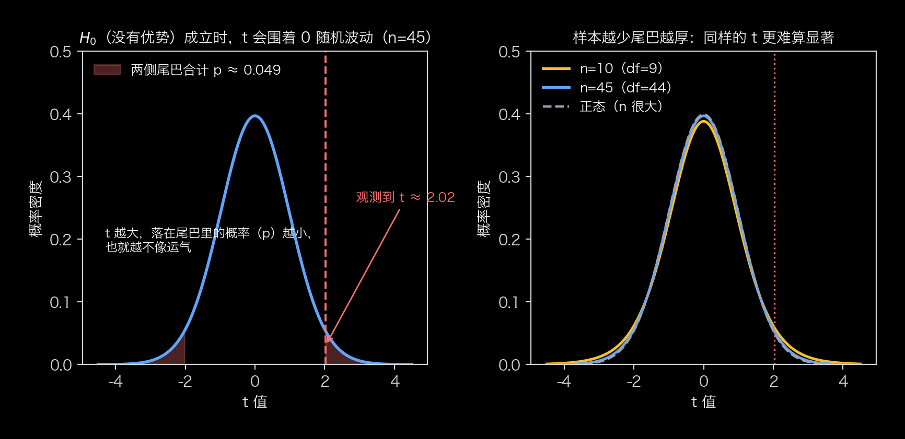
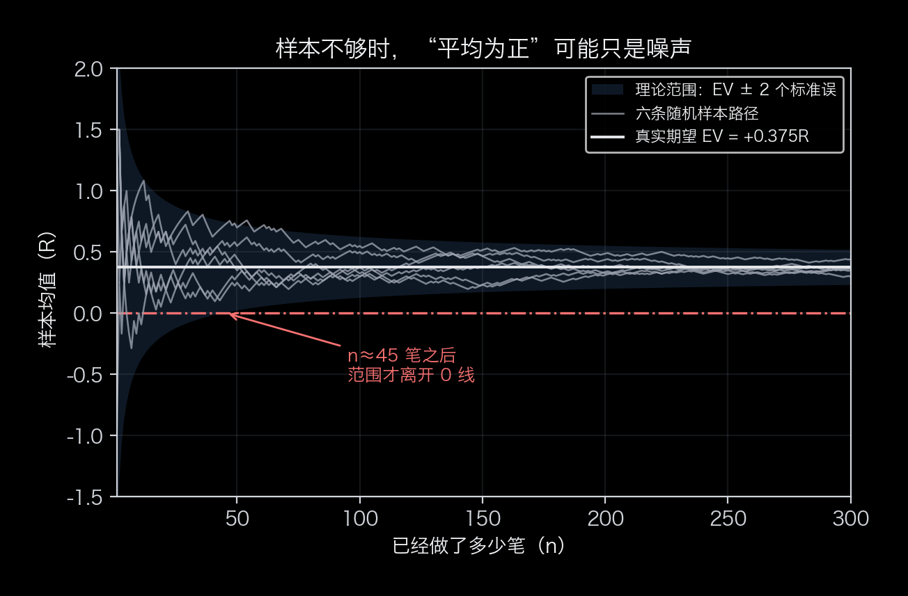
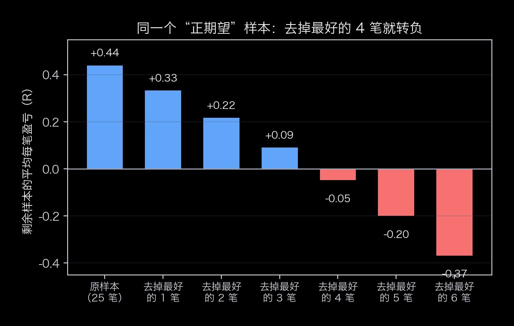
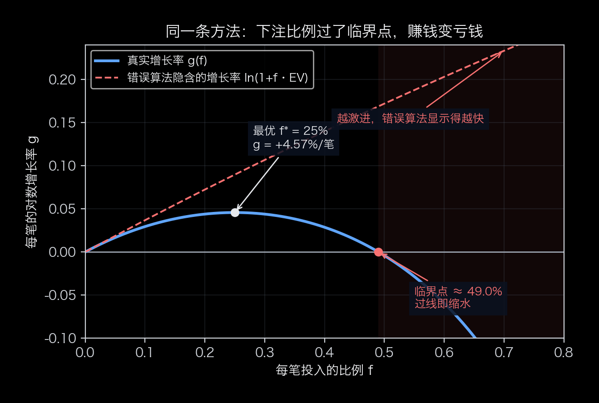
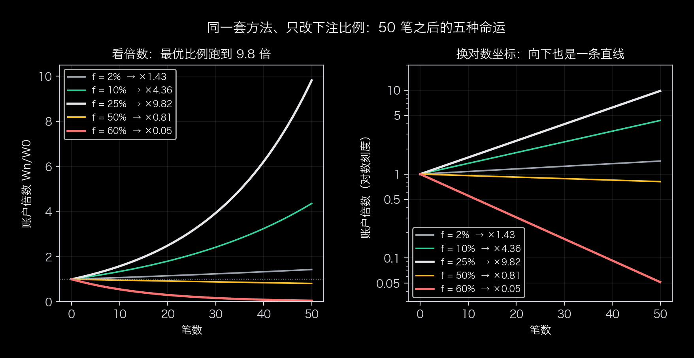
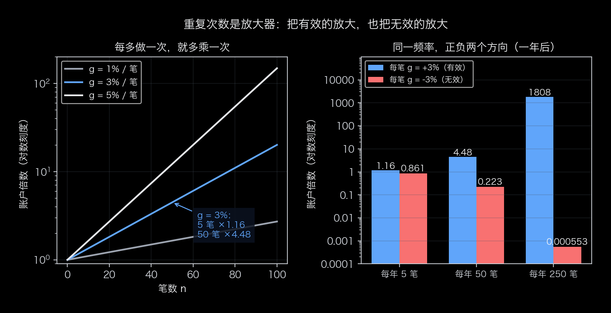

# 你很可能不知道的关于复利的三个关键点

复利这件事很多人很可能根本没想透彻。

**为什么有些人的雪球能越滚越大、越滚越快；而大多数人的雪球滚了几年，还在原地打转，甚至越滚越小？**

运气？天赋？努力程度？都不是关键。

“财富怎么越滚越快”取决于三个关键点：

**① 一个大概率不会亏钱的盈利模式[保不亏]；**
**② 一个能做好风险控制的盈利模式[能风控]；**
**③ 一个盈利速度可加快的盈利模式[超线性]**

先说结论：这三个关键点，多数人只做到第一个，后两个要反直觉得多，也几乎没人系统讲过。以下内容基于比较容易量化的证券交易场景推导，实际上也能用于其它容易量化的场景，对难以量化的场景也具备启发意义。

复利的本质其实就是这一行公式（**$n$ 足够大时**才成立）：
$$\frac{W_n}{W_0}\;\approx\;e^{\,n\cdot g},\qquad g=\mathbb{E}\big[\ln(1+fR)\big]\qquad(1)$$

（$W_0$ 是开始时的本金，$W_n$ 是 $n$ 笔交易之后的本金。这里的“≈”来自大数定律，**笔数 $n$ 要足够大**才贴得近；笔数少时误差可能很大。）
| 符号 | 是什么 | 归哪个关键点管 |
|---|---|---|
| $g$ | **平均增长率**（对数口径） | 关键点一：保不亏 |
| $f$ | 每次投入的资金的**比例** | 关键点二：能风控 |
| $n$ | 第 n 笔交易或冒险 | 关键点三：超线性 |

## 这行公式是怎么推出来的（一步一步拆）

这一行不是凭空定义出来的，是从“每做一次，财富乘一个数”推出来的。为了让尽可能多的读者能够轻松理解，下面六步只用初中数学，每一步都配了具体数字示例。

**第一步：一次动作，就是给财富乘一个倍数。**

假设手里有 1 万块，拿本金的固定比例 $f$ 去冒险——比如 $f=10\%$，也就是 1000 块；这一次冒险的结果可能挣钱也可能亏钱，但是亏钱最多只亏得了 1000 块钱，不论结果是挣是亏，这 1000 块钱肯定会变成某个 1000 的倍数，假设这个倍数为 R，则一次冒险之后 1000 块变为 1000$R$，这个 $R$ 叫做赔率，由于最多只亏得了 1000 块钱，所以 R>=-1。用公式表达这笔的盈亏就是 $f\cdot W_0\cdot R$，于是做完一次冒险总资产变为：

$$W_1=W_0+f\,W_0R=W_0\,(1+fR)$$

把括号里的 $1+fR$ 记作 $m$：**$m$ 就是“这一笔让财富变成原来的 m 倍”的意思**——赚 10% 是 $m=1.1$，亏 5% 是 $m=0.95$。

**第二步：做 $n$ 次，就是乘 $n$ 次。**

$$W_n=W_0\times m_1\times m_2\times\cdots\times m_n$$

每一次都乘在上一次的结果上——这就是“复利”两个字的全部作用：**这一次的本金是上一次的结果，所以赚到的钱自己也会生钱。**

三次分别赚 10%、亏 10%、赚 20%，加法思维会说“净赚 20%”，实际是：

$$1.1\times0.9\times1.2=1.188$$

净赚 18.8%，比 20% 少了 1.2 个百分点。少掉的这点就是波动吃掉的——赚 10% 再亏 10%，回到 0.99，已经亏了 1%。

**第三步：平均每一笔增加多少倍**

$n$ 笔之后，总倍数是 $\prod m_i$。把总倍数开 $n$ 次方得到平均每一笔增加的倍数：

$$G_n=\left(\prod_{i=1}^{n}m_i\right)^{1/n}$$

它的意思是：**如果每一笔都恰好变成 $G_n$ 倍，做 $n$ 次得到的总倍数，与实际一模一样。** 上面三次：$G_3=1.188^{1/3}\approx1.0591$，而 $1.0591^3=1.188$，分毫不差。

**第四步：n 足够大的时候，$G_n$ 会稳定到哪个数？**

小样本计算出的 $G_n$ 不可靠，运气好的时候偏大，运气差的时候偏小。样本足够大的时候会稳定在什么数值范围？如果稳定在小于1的数值范围则亏钱是大概率事件，这不是我们想要看到的结果。

难点在于 $G_n$ 是“乘积开方”，没有一个直接管乘积的极限定理；而我们最终要的不是某一批样本的 $G_n$，是它的长期期望。因此取对数把它的乘法形态变为加法形态：

$$\ln G_n=\frac{1}{n}\ln\frac{W_n}{W_0}=\frac{1}{n}\sum_{i=1}^{n}\ln m_i$$

乘积变成和，“每笔的几何平均”变成“每笔对数收益率的算术平均”，记作 $g_n$——加法上的平均，下一步的大数定律才能派上用场。所以取对数不是为了好算，是为了把乘积翻译成和，让这个量能求极限、求期望。

**第五步：次数够多，这个平均数才会稳定到期望值。**

这就是大数定律：样本越多，样本平均越接近期望。抛硬币一百次，正面比例贴近 50%；做了几百笔之后，$g_n$ 贴近

$$g=\mathbb{E}[\ln m]$$

单笔是随机的，但长期结果由这个期望决定，不由某一笔的好坏决定。

**第六步：把平均值代回去，指数就出来了。**

$$\ln\frac{W_n}{W_0}\approx n\cdot g\quad\Longrightarrow\quad\frac{W_n}{W_0}\approx e^{\,n\,g}$$

注意这两个“≈”是从哪里来的：它们靠的正是第五步——**只有 $n$ 足够大**，样本平均 $g_n$ 才贴近期望 $g$。写成极限更清楚：

$$\frac{1}{n}\ln\frac{W_n}{W_0}\ \xrightarrow{\ n\to\infty\ }\ g$$

也就是说，“约等于”准确说是**对数尺度上的约等于**：$n$ 越大，$\frac1n\ln(W_n/W_0)$ 越贴近 $g$，$e^{ng}$ 给出的长期平均路径越准；但具体到某一段，实际值会围着它上下浮动，不会正好落在上面。

有了这个极限，最后一步只用了对数的反函数：$\ln x=y$ 等价于 $x=e^{y}$，就把和式还原成指数。把 $m=1+fR$ 代回去，就是开头那行公式：

$$g=\mathbb{E}\big[\ln(1+fR)\big],\qquad\frac{W_n}{W_0}\approx e^{\,n\,g}$$

**为什么一定是指数，不是直线？** 因为每一步都在前面的结果上乘一个（长期平均下来）固定的倍数。**“固定倍数反复相乘”就是指数的定义**——只要每笔按本金的比例赚，结果必然是指数；反过来，每笔赚固定金额（比如工资），连乘这一步就不存在，只能是直线。

**$g$ 和 $n$ 的实际威力。** $g=3\%$ 时，做 50 次是 $e^{1.5}\approx4.48$ 倍；想让财富翻倍，需要 $n\approx\ln 2\,/\,g=0.693/0.03\approx23$ 次。$g$ 是每笔的对数收益率，$n$ 是次数，两者相乘就是指数上的角度。

不过 $g=\mathbb{E}[\ln(1+fR)]$ 现在还只是一个写法：它到底多大、$f$ 取多少时才最大，还有待探索。

## 关键点一：一个大概率不会亏钱的盈利模式[保不亏]

[保不亏]不是某一笔赚了或亏了，也不是“听起来能赚”，而是：**长期、大样本看下来，平均每一次是赚的。** 用数学公式表达就是 $\mathrm{EV}=\mathbb{E}[R]>0$。

这里的 $R$ 就是前面提到的赔率，也叫做**风险单位**——把“这一笔最多愿意亏的钱”当作 1 个单位：赢了 2 个风险单位就记 $R=+2$，亏满 1 个就记 $R=-1$。这样记的好处是：$R$ 只看方法的**质量**，与账户多大、每次下注多少都无关。

判断一个方法有没有正期望时，常见的错误有三种：

- 用单笔手感判断——那多半是运气；
- 用入场规则判断——“胜率过半才出手”这类门槛只是纪律，它只告诉你**什么时候不该出手**，不告诉你出手的机会能不能赚（门槛是准入线，不是水平线）；
- 用“最近好像不错”判断——样本太少，看什么都像信号。

一个方法无非是“赢的时候赚多少、输的时候亏多少、各自有多大概率”，平均每笔就是：

$$\mathrm{EV}=\mathbb{E}[R]=p\cdot R_W-q\cdot|R_L|\qquad(2)$$

（$p$ 是胜率，$R_W$ 是赢时赚几个风险单位，$q=1-p$ 是败率，$|R_L|$ 是亏时亏几个风险单位。示例：$p=0.55$、$R_W=1.5$、$|R_L|=1$，算出来 $\mathrm{EV}=+0.375$。）

**EV 不能凭感觉，要用样本估。** 加上标准误（SE）和 $t$ 统计量（$n$ 足够大时近似 $t$ 分布）一起看：

$$\hat{\mathrm{EV}}_n=\frac{1}{n}\sum_{i=1}^{n}R_i\qquad(3\text{a})$$

$$\mathrm{SE}=\frac{\sigma}{\sqrt{n}}\qquad(3\text{b})$$

$$t=\frac{\hat{\mathrm{EV}}_n}{\mathrm{SE}}=\frac{\hat{\mathrm{EV}}_n\sqrt{n}}{\sigma}\qquad(3\text{c})$$

三个式子各管一件事：式 (3a) 是**样本平均**——这次统计下来，每笔平均赚几个风险单位；式 (3b) 是它的**标准误**——这个平均值本身有多不稳；式 (3c) 就是两者相除。

先把 $\mathrm{SE}$ 说清楚：它是 **standard error，标准误**。它不是“某一笔赚多赚少”的波动（那是单笔标准差 $\sigma$），而是“**这个平均值本身有多不可靠**”——同样抽 $n$ 笔、重复很多次，这些平均值会围着真实期望上下浮动，其标准差就是 $\mathrm{SE}=\sigma/\sqrt{n}$。样本越多它越小，而且按 $\sqrt{n}$ 缩小：样本翻 4 倍，$\mathrm{SE}$ 才减半。拿示例算一遍：$\sigma\approx1.24$、$n=45$，$\mathrm{SE}=1.24/\sqrt{45}\approx0.18$——平均值的典型误差约 0.18 个风险单位，而平均值是 $+0.375$，差不多是它的两倍，于是 $t\approx2$。

**$\mathrm{SE}=\sigma/\sqrt{n}$ 是怎么推出来的？** 两步。

**第一步：算平均值本身的方差。** 设单笔收益的方差是 $\sigma^2$（$\sigma$ 就是前面说的单笔标准差）。样本平均是

$$\hat{\mathrm{EV}}_n=\frac{R_1+R_2+\cdots+R_n}{n}$$

方差有两条性质：① 常数提出来要平方，$\mathrm{Var}(cX)=c^2\mathrm{Var}(X)$；② 相互独立的两笔，方差可以直接相加，$\mathrm{Var}(X+Y)=\mathrm{Var}(X)+\mathrm{Var}(Y)$（独立意味着协方差为零；正相关会让方差更大，负相关会让方差更小）。于是

$$\mathrm{Var}\left(\frac{1}{n}\sum_{i=1}^{n}R_i\right)=\frac{1}{n^2}\sum_{i=1}^{n}\mathrm{Var}(R_i)=\frac{1}{n^2}\cdot n\sigma^2=\frac{\sigma^2}{n}$$

**第二步：开平方回到原来的单位。** 方差是波动的平方，所以

$$\mathrm{SE}=\sqrt{\frac{\sigma^2}{n}}=\frac{\sigma}{\sqrt{n}}$$

**这条公式有两个前提：** 一是笔与笔之间不相关——上面的推导用到了“独立时方差可加”，所以没有出现协方差项；真实交易间若存在相关，误差会偏离这个公式（一般形式是 $\mathrm{SE}=\frac{\sigma}{\sqrt n}\sqrt{1+(n-1)\bar\rho}$，$\bar\rho$ 为平均相关系数，正相关放大、负相关缩小），相关性的影响与处理留待后续另文展开。二是 $\sigma$ 是总体波动，实际只能用样本标准差 $s$ 代替，写成 $\hat{\mathrm{SE}}=s/\sqrt{n}$。

**把式 (3a)–(3c) 连起来读：**

> **$t$ = “平均每笔赚多少” ÷ “这个平均数的不确定度”**

分子是式 (3a) 的样本平均（赚多少），分母是式 (3b) 的标准误（这个“赚多少”本身有多不稳）；式 (3c) 把它们一除，就是“按自己的波动当尺子量，这个平均值离 0 有多远”。$t$ 越大，结果越不像运气。

**反过来的判据是置信区间。** 95% 的置信区间大致是 $\hat{\mathrm{EV}}_n\pm1.96\,\mathrm{SE}$。这里的 **1.96** 是“正态分布中间 95% 对应的那个倍数”（统计上叫**临界值**）；样本少的时候要换成 $t$ 分布里对应的倍数——$n=10$ 时约 2.26、$n=45$ 时约 2.02，样本足够大才回到 1.96，所以小样本的区间天生更宽（图 6 右图）。区间若**包含 0**，说明“其实没有优势”这个假设与数据并不矛盾，此时不能按正期望用，只能按“还没验证出来”处理。拿示例看：$\hat{\mathrm{EV}}_n=+0.375$、$\mathrm{SE}\approx0.185$，按 $n=45$ 对应的临界值 2.02 算，区间约 $[0.00,\ 0.75]$，刚好不含 0——对应 $p\approx0.049$，勉强踩在 5% 线上；如果只做了 10 笔（$\mathrm{SE}\approx0.39$，临界值 2.26），区间约 $[-0.51,\ 1.26]$，把 0 包在里面，更不能说“有优势”。

两点别搞混：**不能拒绝“没有优势”，不等于证明了没有优势**，只是样本还分不清；而区间整体压在 0 以下（连上界都小于 0），那是负期望的证据，比“分不清”更糟。**这条“区间含 0 就当没验证出来”的线，就是“在找”和“验真”之间的分界线。**

**为什么是除以标准误，而不是除以 $\sigma$？** 因为要问的问题是：“这个平均值偏离 0 有多远，如果用它自己的波动当尺子，这个偏离算不算大？”除以 $\mathrm{SE}$ 就是在换尺子：

$$t=\frac{\hat{\mathrm{EV}}_n}{\mathrm{SE}}=\frac{\hat{\mathrm{EV}}_n}{\sigma/\sqrt n}=\underbrace{\frac{\hat{\mathrm{EV}}_n}{\sigma}}_{\text{效应量}}\times\sqrt n\qquad(4)$$

分子、分母的单位都是风险单位，一除就消掉了——所以不同方法、不同波动水平，都能放到同一把尺子上比。$\sigma$ 不能当尺子：它是单笔波动，与做了多少笔无关，除以它得到的数不随样本量变化，也就体现不出“样本越多越可信”。$\mathrm{SE}=\sigma/\sqrt n$ 自动把样本量带了进来：$n$ 越大，尺子越细，同样的平均值给出的 $t$ 越大。

写成最后一个形式最直观：**$t$ ＝ 效应量 × $\sqrt n$**。效应越大、样本越多，$t$ 越大。示例参数下（$\hat{\mathrm{EV}}=+0.375$、$\sigma\approx1.24$）：做 10 笔，$\mathrm{SE}\approx0.39$、$t\approx0.96$，淹没在噪声里；做 45 笔，$t\approx2.02$；做 100 笔，$\mathrm{SE}\approx0.12$、$t\approx3.02$。

把它反过来解，就是式 (5) 那个门槛：要求 $t\ge2$，即 $\hat{\mathrm{EV}}\sqrt n/\sigma\ge2$，解出 $n\ge4\sigma^2/\mathrm{EV}^2$——代入示例正好约 45 笔。

**这背后是一次“原假设检验”。** 原假设 $H_0$ 是“这个方法没有正期望（$\mathrm{EV}=0$），观测到的 $+0.375$ 只是运气”。$t$ 就是这个假设下的检验统计量：$t$ 越大，“纯运气能做出这么好的样本”的概率越小。

这里要分清两种概率：**单侧**只问“运气好到 $t$ 这么大”，**双侧**问“运气极端到 $|t|$ 这么大”（正负都算）。示例里 $t\approx2.02$：单侧 $p\approx0.025$，双侧 $p\approx0.049$。我们只关心正期望，所以“纯运气做出这么漂亮的样本”应该看**单侧 2.5%**；本文后面用 $t\ge2$ 做门槛，是取更保守的**双侧 5%** 口径（对应单侧 2.5%）。注意结论的方向：**不能拒绝 $H_0$，不等于证明没有正期望**，只说明现有样本还分不清是优势还是运气。

*图 6：左图——先假设方法没有优势（$H_0$），$t$ 会围着 0 随机波动；观测到的 $t\approx2.02$ 落在两侧尾巴里：两侧合计是双侧 $p\approx0.049$（更保守的口径），只看右边那一侧是单侧 $p\approx0.025$——“纯运气做出这么漂亮的样本”的概率约 2.5%。右图——同样是 $t=2.02$，样本越少尾巴越厚、$p$ 越大：$n=10$ 时单侧 $p\approx0.037$，$n=45$ 时约 $0.025$，样本足够大才逼近正态的 $0.022$。**所以“$t$ 大”不是绝对标准，要看它相对于自己那条曲线走了多远。***

**为什么是 $t$ 分布，而不是正态分布？** 差别全在分母。如果总体标准差 $\sigma$ 已知，$(\hat{\mathrm{EV}}_n-0)/(\sigma/\sqrt n)$ 服从标准正态，这叫 $z$ 检验。但现实中 $\sigma$ 不知道，只能用样本标准差 $s$ 估计，统计量就变成

$$t=\frac{\hat{\mathrm{EV}}_n-0}{s/\sqrt n}$$

麻烦在于：分母里的 $s$ 自己也是随机的（换一批样本，$s$ 就变），它会时大时小。**如果每笔收益独立且服从正态分布**，可以证明

$$t=\frac{z}{\sqrt{\chi^2_{n-1}/(n-1)}}$$

分子是一个标准正态（来自样本均值的波动），分母里的 $\chi^2_{n-1}$ 来自样本方差——$(n-1)s^2/\sigma^2$ 服从自由度 $n-1$ 的卡方分布，且与分子相互独立。这种“正态 ÷ 卡方除以自由度”的比值，正是 **$t$ 分布**的定义，自由度是 $n-1$（$n$ 个数据里用掉一个去估计均值，剩下 $n-1$ 个自由度）。

因为分母自己会抖，$t$ 分布比正态**尾部更厚**：样本越少，$s$ 越不靠谱，尾部越厚，“小概率的极端值”越容易出现。所以门槛也随样本量变：自由度 9（$n=10$）时双侧 5% 的临界值是 2.26，自由度 44（$n=45$）时是 2.02，样本足够多才逼近正态的 1.96。这就是文中“$t$ 至少到 2”只是粗略说法的原因——小样本要更严；而如果只关心“有没有正期望”（单侧检验），门槛可以放宽到 1.65 左右（那是大样本值，45 笔时实际是 1.68）。

**三个使用前提（被破坏时 $t$ 会骗人）：**

- 交易之间不相关：正相关会让真实误差变大、$t$ 虚高，负相关则相反（一般形式见上文那句话）；
- $\hat{\mathrm{EV}}_n$ 近似正态：这条在交易里最容易破——单笔收益往往偏斜、厚尾（下一段展开）；
- 没有挑过数据：试了十几个参数再挑 $t$ 最大的那个，显著性会被“数据窥探”吃掉——多重比较要打折。

**那交易收益真的正态吗？基本不是。** 上面“精确服从 $t$ 分布”的推导，前提是每笔收益独立且服从正态分布。交易收益这两条都很难满足：

- **上下界不对称**：文章的风险单位模型里，一笔最多亏 1R，但赢的方向没有上限（赚几个风险单位都行），分布本身就是偏的，不是正态那种两侧对称的钟形；
- **尾部比正态厚得多**：极端行情、跳空、黑天鹅，一笔就能抵掉几十笔的正常波动；正态假设会系统性地低估“大亏”出现的概率；
- **波动会聚集**：大波动后面常跟着大波动，方差本身在变，不是独立同分布；
- **交易之间常相关**：同一波行情里连续同向持仓、或者危机时各类资产一起跌，独立性打折（这一层本文不展开）。

所以现实中的 $t$ 统计量只是**近似**服从 $t$ 分布：$n$ 越大、分布越不极端，近似越好；$n$ 小又厚尾的时候，$t$ 检验声称的“5% 显著性”会被带偏——多数情况是偏松（把运气当成优势），但也可能偏严，取决于分布形状和样本量。

**不依赖正态假设的做法：** 用 bootstrap（重采样）——把已有样本反复重抽，算出成千上万个“平均值”，直接看这些平均值在 0 附近怎么分布，用它算经验 $p$ 值和标准误；厚尾、偏斜都不影响这套做法。也可以先用截尾均值（去掉最极端的几笔再算），并在报告时给区间、给效应量，而不是只给一个“显著 / 不显著”。

**顺带说名字。** $t$ 不是哪个词的缩写，它就是字母 $t$；全称是 **Student's t**（学生 $t$），分布叫 **Student's $t$ 分布**。“Student”不是“学生”的意思，而是笔名：1908 年，Guinness 酒厂的统计师 William Sealy Gosset 因公司禁止员工发表论文，用这个笔名在 *Biometrika* 上发表了关于 $t$ 分布的研究；后来 Fisher 把理论补全，“Student”就成了正式名称。对比一下：$z$ 是 z-score（标准分数），$F$ 分布取自 Fisher 的姓氏首字母——只有 $t$ 用的是笔名。

要攒多少样本才够？粗略地说，让 $t$ 至少到 2，需要这么多笔：

$$n\ \gtrsim\ \frac{4\sigma^2}{\mathrm{EV}^2}\qquad(5)$$

代入示例参数（$\sigma\approx1.24$），算出来是**约 45 笔**——这是按双侧 5%（$t\ge2$）的保守口径；如果只做单侧检验、门槛放到 $1.65$ 左右，样本只需**约 31 笔**。也就是说：一个真实存在的 +0.375R 优势，也要三十到四十多笔才能在统计上站稳；样本不到这个量级，“我最近觉得它很准”都还只是噪声（图 1）。

**第三，“平均为正”还有两个坑。**

- **均值会被少数几笔拉高。** 赢的时候赢得多、输的时候亏得少（右偏分布）时，均值可以很好看，中位数却是负的——“平均赚”不等于“一半以上的次数在赚”。
- **“正”可能只靠少数几笔撑着。** 把最好的那几笔拿掉再看一遍——这叫稳健性检验，也是“这个平均到底被多少笔撑起来”最直接的做法（图 2）。

*图 1：真实期望只有 +0.375R，但样本少的时候，六条随机样本路径的“平均值”能从 −1R 晃到 +1.5R；约 45 笔之后，理论区间才离开 0 线。**早期看到的“很准”或“没用”，大多只是样本数还没攒够。**（示意模拟：示例参数、每笔独立。）*

*图 2：一组人为构造的 25 笔样本（9 笔赢 +3R、16 笔亏 −1R），平均每笔 +0.44R，看着很赚钱；**把最好的 4 笔（16%）拿掉，平均就变成 −0.05R**——赚不赚钱全靠那几笔。正期望是真的，但脆弱。*

**一句话：没经过验证的，只能算“在找”；验证靠的不是感觉，是样本统计——平均为正，且这个“正”撑得住去掉几笔大赚。**

## 关键点二：每笔不贪多

先给一个反直觉的事实：**就算方法真的能赚钱，下注太多，账户也会越做越亏。**

拿一组公开示例参数算一遍。假设有一套方法：

- 胜率 55%，赢的时候赚 1.5 个风险单位、输的时候亏 1 个风险单位；
- 平均每笔 = 0.55 × 1.5 − 0.45 × 1 = **+0.375 个风险单位**，是正的（就是上一节那套）。

再假设一个习惯：每做一笔，拿**当前本金的固定比例**去冒险——这就是“固定比例下注”。同一套方法，只改这个比例，做 50 笔之后：

| 每笔冒险 | 真实每笔增长 $g$ | 50 笔后（真实） | 错误算法说（每笔） |
|---|---|---|---|
| 2% | +0.72% | ×1.43（慢，但在涨） | +0.75% |
| 10% | +2.95% | ×4.36 | +3.75% |
| 25% | **+4.57%** | **×9.82（数学最优）** | +9.38% |
| 50% | **−0.41%** | **×0.81（反而缩水）** | +18.75% |
| 60% | −5.93% | ×0.05（快速缩水） | +22.50% |

方法没变、胜率也没变，只是下注比例过了头——**一套平均每笔赚钱的方法，做出来的却是一个不断亏钱的账户。**

为什么？两个原因。

**第一，复利是乘出来的，盈亏不对称。** 亏掉一半，要翻倍才能回本；先亏一半、再赚一半，账户只剩 0.75 倍。赚和亏轮流出现时，“亏”对“赚”的拖累比直觉大得多——同样的平均收益，波动越大，账户实际滚得越慢。这个拖累有确切的名字和公式，见下面的数学版。

**第二，有一个顺手的错误算法，会专门骗你往大里下。** 它会这样算：平均每笔赚 0.375 个单位，那每笔下注 60%，每笔不就赚 22.5%？——这个算法漏掉了波动，会算出一条永远向上的直线，把“越激进”显示成“越快”。真实情况是：60% 那一行，账户在缩水。更刺眼的对比如下——**同一个 60%，错误算法说 50 笔后是 ×25,516，真实是 ×0.05，差了约五十万倍。**

### 数学版（可跳过）

**第一步：单笔。**（前言里已经推过整条链，这里用符号再走一次，重点放在后两步：$g$ 到底怎么算，以及 $f$ 变大会发生什么。）设第 $i$ 笔冒险的比例为 $f$，风险敞口就是 $M_i=f\cdot W_{i-1}$；这笔的盈亏是 $R_i$ 个风险单位，于是盈亏金额 $=f\cdot W_{i-1}\cdot R_i$，账户递推为

$$W_i=W_{i-1}+f\,W_{i-1}R_i=W_{i-1}\,(1+fR_i)$$

（顺带一个漂亮的性质：单笔收益率 $=W_i/W_{i-1}-1=fR_i$，**与账户大小无关**——10 万和 100 万本金，每笔的刻度一样，这就是“固定比例”比“固定金额”干净的地方。）

**第二步：连乘。** 一笔一笔乘下去：

$$W_n=W_0\prod_{i=1}^{n}(1+fR_i)\qquad\Longrightarrow\qquad \text{累计收益率}=\prod_{i=1}^{n}(1+fR_i)-1$$

这是**精确式**：真实发生的复利就是这个乘积，没有任何近似。

**第三步：错在哪。** 有人把乘积直接换成幂：

$$W_n\ \overset{?}{\approx}\ W_0\,(1+f\,\mathrm{EV})^{n}$$

这个式子看起来特别顺眼：它永远向上，越激进涨得越快——而它是错的。把精确式两边取对数（乘法变加法）、再除以 $n$：

$$\frac{1}{n}\ln\frac{W_n}{W_0}=\frac{1}{n}\sum_{i=1}^{n}\ln(1+fR_i)\ \xrightarrow{\ n\to\infty\ }\ \mathbb{E}\big[\ln(1+fR)\big]=:g$$

（大数定律：样本平均趋于期望。所以**真实增长率是 $g=\mathbb{E}[\ln(1+fR)]$，不是 $f\cdot\mathrm{EV}$**。）

那 $g$ 和 $f\cdot\mathrm{EV}$ 差在哪？答案在 **Jensen 不等式**里——对数函数是凹的，凹函数的“期望”不超过“期望的函数”：

$$\mathbb{E}\big[\ln(1+fR)\big]\ \le\ \ln\Big(\mathbb{E}\big[1+fR\big]\Big)=\ln(1+f\,\mathrm{EV})$$

等号**只在没有波动时**成立（每一笔都恰好赚 EV）。只要盈亏有波动，真实增长率就严格更小——这个差距叫**波动率拖累（volatility drag）**。

**第四步：把差距算出来。** 对小 $x$ 有泰勒展开 $\ln(1+x)\approx x-\frac{x^2}{2}$，取 $x=fR$：

$$g=\mathbb{E}\big[\ln(1+fR)\big]\ \approx\ \underbrace{f\cdot \mathrm{EV}}_{\text{算术增长}}\ -\ \underbrace{\frac{f^2}{2}\,\mathbb{E}[R^2]}_{\text{方差惩罚}}$$

**第一项是算术增长，第二项是方差惩罚。** 这就是“同样的平均收益，波动越大、真实复利越低”的数学来源：$g$ 在 $f^*$ 处见顶，往下走；错误算法只有第一项，所以它永远向上。

**第五步：最优比例与临界点。** 对 $f$ 求导，令导数为 0，得到增长最快的下注比例：

$$f^*\ \approx\ \frac{\mathrm{EV}}{\mathbb{E}[R^2]}\quad(\text{近似})$$

若每笔只有“赢、输”两种结果，还有不做近似的精确解：

$$f^*=\frac{pR_W-q\,|R_L|}{R_W\,|R_L|}=\frac{p}{|R_L|}-\frac{q}{R_W}$$

（这正是经典的**凯利公式**。代入示例：$f^*=0.55-0.45/1.5=25\%$，与表中“25% 最优”一致。）

**增长速度转负的临界点**由 $g=0$ 给出，在二阶近似下它恰好是最优值的两倍：

$$g>0\ \Longleftrightarrow\ f<\frac{2\,\mathrm{EV}}{\mathbb{E}[R^2]}\ \approx\ 2f^*\qquad(\text{近似})$$

示例参数下精确解是 $f_c\approx49.0\%$——**超过它，同样的方法、同样的胜率，账户长期必然缩水。** 这就是表里 50%、60% 两行变负的原因。（“两倍凯利”的这个近似有适用边界——实算就能找出反例，别把它当无条件红线。）

*图 3：蓝线是真实的每笔增长率 $g(f)$——先升后降，在 25% 见顶、约 49% 处穿过零线；红线虚线是错误算法隐含的增长率——**它只会一路向上**。两张脸差在“方差惩罚”这一项上。*

*图 4：同一套方法，只改下注比例，50 笔之后的五种结局：2% 慢涨（×1.43）、10% 中速（×4.36）、25% 最快（×9.82）、50% 微跌（×0.81）、60% 快跌（×0.05）。右图换对数坐标后，曲线都是直线——**斜率就是每笔增长率 $g$；向下那条，斜率是负的。***

### 那到底下多少算“不贪”

**先分清“固定比例”和“固定金额”，这是复利与工资的分界线。** 固定金额下注，每笔赚的钱是常数 $c$：$W_n=W_0+n\,c$，做一万次也还是一条直线。固定比例下注，每笔赚的钱跟着本金一起长大：$W_n=W_0\prod(1+fR_i)$，本金越大，同样一笔赚的越多，于是才有指数。上班拿工资属于前者——一天卖一天的时间，单价不随你的资产放大。这不是说工资不好（它是现金流的底座），而是说**它不在这套复利逻辑里**：想让钱滚起来，得先有一个“收益跟着本金一起放大”的载体。弄清了这一层，再谈比例选多大。**因此，“② 每笔不贪多”的准确说法是“每笔只押本金的固定比例，且比例不超过最优值”——固定工资不满足这一条，它只是“每笔金额固定”。**

数学上有一个最优比例（这套参数里是 25%），但**现实中没人用满**——因为你估计的 55%、1.5 这些数字本身有误差，误差会把“最优”变成“灾难”：$f^*$ 附近曲线是平的，$f$ 稍微过一点，$g$ 就开始往下走，参数估错的代价不对称。常见做法是**分数凯利**：只用最优值的一部分，

$$f=\lambda f^*,\qquad \lambda\in\left[\tfrac14,\ \tfrac12\right]$$

先保证活得久，再谈快。

**一句话：下注的上限不是胆量，是数学。赚得稳（低方差）比赚得猛（高均值）更重要。**

## 关键点三：把有效的事重复够多次

这条最简单，也最容易被误解。

先记住一个反常识的结论：**复利靠“做了多少次”，不靠“等了多久”。** 每做一次，账户才乘以一个数；空仓的时候什么都没发生——不赚不亏，也不“复利”。同样是 100 次，一年做完和五年做完，结果完全一样（前提是每笔的统计特征不变）。“长期主义”如果只剩下“等”，那它什么都没做。

数学上，时间只通过一个渠道进来：一段时间 $t$ 内能做多少次，取决于频率 $\nu$（比如每年做多少笔）：

$$n=\nu\cdot t\qquad\Longrightarrow\qquad \frac{W(t)}{W_0}\ \approx\ e^{\,n\,g}=e^{\,(\nu g)\,t}$$

（这里的“≈”同样要求 $n$ 足够大：时间越长、频率越高，$n$ 才越攒得够——这也正是时间只能通过“多做”起作用的原因。）

也就是说：**年化对数增长率 = 频率 × 每笔增长率**。复利是被“做了一次又一次”这个事件驱动的，日历时间本身不产生任何东西。

再看次数的威力：假设每笔的增长率 $g=3\%$（示意数字），做 5 次是 ×1.16，做 50 次是 ×4.48——每上一个台阶，结果都按乘法拉开；而频率把这件事再放大：每笔 3%、一年做 250 笔，一年后是 ×1808（仍是示意数字）——**这也是为什么“多做”既有吸引力，又危险。**

*图 5：左图——同样的每笔增长率，重复次数每加一段，倍数就再乘一次（对数坐标下是直线）；右图——同一频率放到正负两个方向上，结果是对称的放大：有效的被放大，无效的也被放大。*

### 但这一条有个必须说清楚的前提

**③ 是放大器，不是发动机。**

放大器把正期望放大，也把负期望放大。前两个关键点不成立的时候——方法没验过、下注又过头——“多做”不会让你更快变富，只会让你更快亏完：**负的东西，做得越多错得越快**（$g<0$ 时 $e^{ng}$ 随 $n$ 衰减，频率 $\nu$ 越大衰减越猛）。

所以准确的说法不是“多做”，而是“**在 ①② 成立的前提下**，把已被验证有效的事，重复够多次”。为了凑次数去做不该做的动作，是往乘法链里塞负数。等不到好机会的时候，空仓不是损失——不赚不亏，只是暂停。

**一句话：时间不是复利的原因，只是复利的容器；决定速度的是“做了多少次”。**

## 三个关键点合起来

| 关键点 | 对应的数学量 | 决定什么 |
|---|---|---|
| ① 真方法 | $\mathrm{EV}=\mathbb{E}[R]>0$，且统计上站得住 | 方向——$g$ 的符号从哪来 |
| ② 不贪多 | $f\le f^*$，实践上取分数凯利 | 生死——$g$ 是正还是负 |
| ③ 重复够多 | $n=\nu t$，在 ①② 成立后尽可能大 | 速度——指数上的乘数 |

回头看总公式 $\dfrac{W_n}{W_0}\approx e^{ng}$（$n$ 足够大时）：**$g$ 由 ① 和 ② 共同决定**（$g\approx f\cdot\mathrm{EV}-\frac{f^2}{2}\mathbb{E}[R^2]$），**$n$ 由 ③ 决定**。三个都对上，钱才会越挣越多、越挣越快；只做到一个——尤其是只做到第一个——就是“有方法，却始终没滚起来”的原因。而现在，另外两个长什么样你也见过了。

最后，把话说完整：

- 文中所有数字都来自**公开示例参数的演算**，用来讲结构——不是收益承诺；“越滚越快”以 ①② 都成立为前提；
- 你的方法到底有没有正期望，只能用自己的样本去验证，别人替不了你；样本不够时，按保守的口径读；
- 复利模型假设“每笔最多亏 1 个风险单位”，现实里可能出现跳空、滑点，亏损也可能超出预期，实际分布比模型更野——留足余量；
- 这不是投资建议。而且换个场景也一样：任何“可重复、每次投入有限、长期平均为正”的事——做内容、做产品、练手艺——快慢都由这三个关键点决定。

不妨拿自己的账对一遍：**平均每一次，是赚是亏（$g$ 的符号）？每次投入多大（$f$ 过线没有）？有没有在重复做那件已经验证对的事（$n$ 够不够）？**

你的钱滚得快还是慢，全部原因就在这三个答案里。

---

*本文所用示例参数为公开演算示例，不代表任何实际策略、实盘记录或收益承诺，亦不构成投资建议。*
