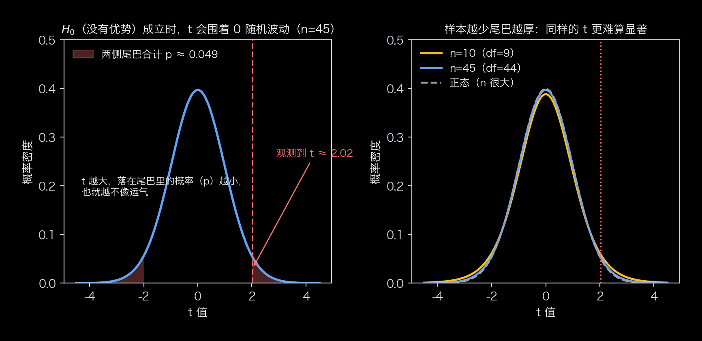
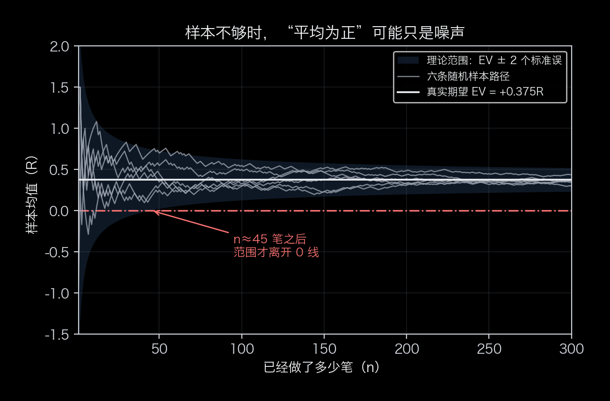
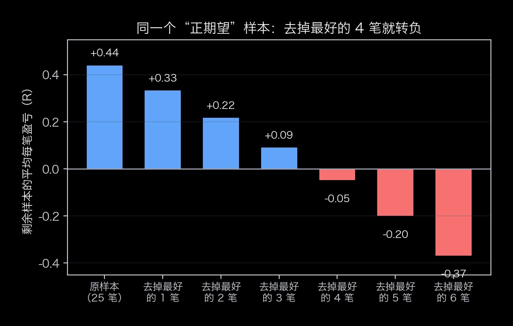

# 怎么证明一个方法真的不亏

上一篇把复利写成一行公式：$\frac{W_n}{W_0}\approx e^{\,n\,g}$，其中 $g=\mathbb{E}\big[\ln(1+fR)\big]$。**$g$ 的符号决定财富往哪个方向滚**：正的越滚越大，负的越滚越小，做多少次都改不了方向。所以三个关键点里，第一个必须先回答——这套方法到底赚不赚钱。

先说结论：**靠样本，不靠感觉。** 一套胜率 55%、赢 1.5R、亏 1R 的方法，算术上每笔净赚 0.375R，看着很赚钱，也要三十到四十多笔样本才能在统计上站稳；没到这个量级，看什么都像信号。

## 关键点一：一个大概率不会亏钱的盈利模式[保不亏]

[保不亏]不是某一笔赚了或亏了，也不是“听起来能赚”，而是：**长期、大样本看下来，平均每一次是赚的。** 用数学公式表达就是 $\mathrm{EV}=\mathbb{E}[R]>0$。

这里的 $R$ 就是上一篇里的赔率，也叫做**风险单位**——把“这一笔最多愿意亏的钱”当作 1 个单位：赢了 2 个风险单位就记 $R=+2$，亏满 1 个就记 $R=-1$。这样记的好处是：$R$ 只看方法的**质量**，与账户多大、每次下注多少都无关。

判断一个方法有没有正期望时，常见的错误有三种：

- 用单笔手感判断——那多半是运气；
- 用入场规则判断——“胜率过半才出手”这类门槛只是纪律，它只告诉你**什么时候不该出手**，不告诉你出手的机会能不能赚（门槛是准入线，不是水平线）；
- 用“最近好像不错”判断——样本太少，看什么都像信号。

一个方法无非是“赢的时候赚多少、输的时候亏多少、各自有多大概率”，平均每笔就是：

$$\mathrm{EV}=\mathbb{E}[R]=p\cdot R_W-q\cdot|R_L|\qquad(2)$$

（$p$ 是胜率，$R_W$ 是赢时赚几个风险单位，$q=1-p$ 是败率，$|R_L|$ 是亏时亏几个风险单位。示例：$p=0.55$、$R_W=1.5$、$|R_L|=1$，算出来 $\mathrm{EV}=+0.375$。）

**EV 不能凭感觉，要用样本估。** 加上标准误（SE）和 $t$ 统计量（$n$ 足够大时近似 $t$ 分布）一起看：

$$\hat{\mathrm{EV}}_n=\frac{1}{n}\sum_{i=1}^{n}R_i\qquad(3\text{a})$$

$$\mathrm{SE}=\frac{\sigma}{\sqrt{n}}\qquad(3\text{b})$$

$$t=\frac{\hat{\mathrm{EV}}_n}{\mathrm{SE}}=\frac{\hat{\mathrm{EV}}_n\sqrt{n}}{\sigma}\qquad(3\text{c})$$

三个式子各管一件事：式 (3a) 是**样本平均**——这次统计下来，每笔平均赚几个风险单位；式 (3b) 是它的**标准误**——这个平均值本身有多不稳；式 (3c) 就是两者相除。

先把 $\mathrm{SE}$ 说清楚：它是 **standard error，标准误**。它不是“某一笔赚多赚少”的波动（那是单笔标准差 $\sigma$），而是“**这个平均值本身有多不可靠**”——同样抽 $n$ 笔、重复很多次，这些平均值会围着真实期望上下浮动，其标准差就是 $\mathrm{SE}=\sigma/\sqrt{n}$。样本越多它越小，而且按 $\sqrt{n}$ 缩小：样本翻 4 倍，$\mathrm{SE}$ 才减半。拿示例算一遍：$\sigma\approx1.24$、$n=45$，$\mathrm{SE}=1.24/\sqrt{45}\approx0.18$——平均值的典型误差约 0.18 个风险单位，而平均值是 $+0.375$，差不多是它的两倍，于是 $t\approx2$。

**$\mathrm{SE}=\sigma/\sqrt{n}$ 是怎么推出来的？** 两步。

**第一步：算平均值本身的方差。** 设单笔收益的方差是 $\sigma^2$（$\sigma$ 就是前面说的单笔标准差）。样本平均是

$$\hat{\mathrm{EV}}_n=\frac{R_1+R_2+\cdots+R_n}{n}$$

方差有两条性质：① 常数提出来要平方，$\mathrm{Var}(cX)=c^2\mathrm{Var}(X)$；② 相互独立的两笔，方差可以直接相加，$\mathrm{Var}(X+Y)=\mathrm{Var}(X)+\mathrm{Var}(Y)$（独立意味着协方差为零；正相关会让方差更大，负相关会让方差更小）。于是

$$\mathrm{Var}\left(\frac{1}{n}\sum_{i=1}^{n}R_i\right)=\frac{1}{n^2}\sum_{i=1}^{n}\mathrm{Var}(R_i)=\frac{1}{n^2}\cdot n\sigma^2=\frac{\sigma^2}{n}$$

**第二步：开平方回到原来的单位。** 方差是波动的平方，所以

$$\mathrm{SE}=\sqrt{\frac{\sigma^2}{n}}=\frac{\sigma}{\sqrt{n}}$$

**这条公式有两个前提：** 一是笔与笔之间不相关——推导用的是“独立时方差可加”，所以没有协方差项；一旦相关，误差会偏离它（一般形式是 $\mathrm{SE}=\frac{\sigma}{\sqrt n}\sqrt{1+(n-1)\bar\rho}$，$\bar\rho$ 为平均相关系数，正相关放大、负相关缩小，处理见《当复利的假设被打破》）。二是 $\sigma$ 是总体波动，实际只能用样本标准差 $s$ 代替，写成 $\hat{\mathrm{SE}}=s/\sqrt{n}$。

**把式 (3a)–(3c) 连起来读：**

> **$t$ = “平均每笔赚多少” ÷ “这个平均数的不确定度”**

换成大白话就是：赚得越多、这个“赚”本身越稳，$t$ 越大，结果越不像运气。

**反过来的判据是置信区间。** 95% 的置信区间大致是 $\hat{\mathrm{EV}}_n\pm1.96\,\mathrm{SE}$。这里的 **1.96** 是“正态分布中间 95% 对应的那个倍数”（统计上叫**临界值**）；样本少的时候要换成 $t$ 分布里对应的倍数——$n=10$ 时约 2.26、$n=45$ 时约 2.02，样本足够大才回到 1.96，所以小样本的区间天生更宽（图 6 右图）。区间若**包含 0**，说明“其实没有优势”这个假设与数据并不矛盾，此时不能按正期望用，只能按“还没验证出来”处理。拿示例看：$\hat{\mathrm{EV}}_n=+0.375$、$\mathrm{SE}\approx0.185$，按 $n=45$ 对应的临界值 2.02 算，区间约 $[0.00,\ 0.75]$，刚好不含 0——对应 $p\approx0.049$，勉强踩在 5% 线上；如果只做了 10 笔（$\mathrm{SE}\approx0.39$，临界值 2.26），区间约 $[-0.51,\ 1.26]$，把 0 包在里面，更不能说“有优势”。

两点别搞混：**不能拒绝“没有优势”，不等于证明了没有优势**，只是样本还分不清；而区间整体压在 0 以下（连上界都小于 0），那是负期望的证据，比“分不清”更糟。**这条“区间含 0 就当没验证出来”的线，就是“在找”和“验真”之间的分界线。**

**为什么是除以标准误，而不是除以 $\sigma$？** 因为要问的问题是：“这个平均值偏离 0 有多远，如果用它自己的波动当尺子，这个偏离算不算大？”除以 $\mathrm{SE}$ 就是在换尺子：

$$t=\frac{\hat{\mathrm{EV}}_n}{\mathrm{SE}}=\frac{\hat{\mathrm{EV}}_n}{\sigma/\sqrt n}=\underbrace{\frac{\hat{\mathrm{EV}}_n}{\sigma}}_{\text{效应量}}\times\sqrt n\qquad(4)$$

分子、分母的单位都是风险单位，一除就消掉了，所以不同方法、不同波动水平能放到同一把尺子上比。$\sigma$ 不能当尺子：它是单笔波动，与做了多少笔无关，除以它得到的数不随样本量变化；$\mathrm{SE}=\sigma/\sqrt n$ 才把 $n$ 带了进来——$n$ 越大，尺子越细，同样的平均值给出的 $t$ 越大。

写成最后一个形式最直观：**$t$ ＝ 效应量 × $\sqrt n$**。效应越大、样本越多，$t$ 越大。示例参数下（$\hat{\mathrm{EV}}=+0.375$、$\sigma\approx1.24$）：做 10 笔，$\mathrm{SE}\approx0.39$、$t\approx0.96$，淹没在噪声里；做 45 笔，$t\approx2.02$；做 100 笔，$\mathrm{SE}\approx0.12$、$t\approx3.02$。

把它反过来解，就是式 (5) 那个门槛：要求 $t\ge2$，即 $\hat{\mathrm{EV}}\sqrt n/\sigma\ge2$，解出 $n\ge4\sigma^2/\mathrm{EV}^2$——代入示例正好约 45 笔。

**这背后是一次“原假设检验”。** 原假设 $H_0$ 是“这个方法没有正期望（$\mathrm{EV}=0$），观测到的 $+0.375$ 只是运气”。$t$ 就是这个假设下的检验统计量：$t$ 越大，“纯运气能做出这么好的样本”的概率越小。

这里要分清两种概率：**单侧**只问“运气好到 $t$ 这么大”，**双侧**问“运气极端到 $|t|$ 这么大”（正负都算）。示例里 $t\approx2.02$：单侧 $p\approx0.025$，双侧 $p\approx0.049$。我们只关心正期望，所以“纯运气做出这么漂亮的样本”应该看**单侧 2.5%**；本文后面用 $t\ge2$ 做门槛，是取更保守的**双侧 5%** 口径（对应单侧 2.5%）。

*图 6：左图——先假设方法没有优势（$H_0$），$t$ 会围着 0 随机波动；观测到的 $t\approx2.02$ 落在两侧尾巴里：两侧合计是双侧 $p\approx0.049$（更保守的口径），只看右边那一侧是单侧 $p\approx0.025$——“纯运气做出这么漂亮的样本”的概率约 2.5%。右图——同样是 $t=2.02$，样本越少尾巴越厚、$p$ 越大：$n=10$ 时单侧 $p\approx0.037$，$n=45$ 时约 $0.025$。**所以“$t$ 大”不是绝对标准，要看它相对于自己那条曲线走了多远。***

**为什么用 $t$ 分布，而不是正态？** 因为总体波动 $\sigma$ 不知道，只能用样本标准差 $s$ 估计；样本少时这个估计本身误差就大，比值不再是正态，而是**尾部更厚**的 $t$ 分布。于是门槛随样本量变：同样 95% 的把握，$n=10$ 要用 2.26 倍标准误、$n=45$ 用 2.02 倍，样本足够大才回到 1.96（图 6 右图）——这也是“$t$ 至少到 2”只是粗略说法的原因。只关心“有没有正期望”（单侧检验）时，门槛可以放到 1.65 左右（大样本值，45 笔时实际是 1.68）。**但 $t$ 只是近似：** 它要求每笔独立且近似正态，真实交易的收益往往两条都不满足，失真方向与替代做法见《当复利的假设被打破》（“Student”这个笔名的来历也在那篇）。

要攒多少样本才够？粗略地说，让 $t$ 至少到 2，需要这么多笔：

$$n\ \gtrsim\ \frac{4\sigma^2}{\mathrm{EV}^2}\qquad(5)$$

代入示例参数（$\sigma\approx1.24$），算出来是**约 45 笔**——这是按双侧 5%（$t\ge2$）的保守口径；如果只做单侧检验、门槛放到 $1.65$ 左右，样本只需**约 31 笔**。也就是说：一个真实存在的 +0.375R 优势，也要三十到四十多笔才能在统计上站稳；样本不到这个量级，“我最近觉得它很准”都还只是噪声（图 1）。

**第三，“平均为正”还有两个坑。**

- **均值会被少数几笔拉高。** 赢的时候赢得多、输的时候亏得少（右偏分布）时，均值可以很好看，中位数却是负的——“平均赚”不等于“一半以上的次数在赚”。
- **“正”可能只靠少数几笔撑着。** 把最好的那几笔拿掉再看一遍——这叫稳健性检验，也是“这个平均到底被多少笔撑起来”最直接的做法（图 2）。

*图 1：真实期望只有 +0.375R，但样本少的时候，六条随机样本路径的“平均值”能从 −1R 晃到 +1.5R；约 45 笔之后，理论区间才离开 0 线。**早期看到的“很准”或“没用”，大多只是样本数还没攒够。**（示意模拟：示例参数、每笔独立。）*

*图 2：一组人为构造的 25 笔样本（9 笔赢 +3R、16 笔亏 −1R），平均每笔 +0.44R，看着很赚钱；**把最好的 4 笔（16%）拿掉，平均就变成 −0.05R**——赚不赚钱全靠那几笔。正期望是真的，但脆弱。*

**一句话：没经过验证的，只能算“在找”；验证靠的不是感觉，是样本统计——平均为正，且这个“正”撑得住去掉几笔大赚。**

## 验过了，才轮到押多少

$g$ 的符号验出来是正的，只说明方向对了。**它不告诉你每笔该押多少**——下一篇会给出一个更反直觉的结果：同一套方法，押 25% 是 50 笔 $\times9.82$，押 50% 是 $\times0.81$，账户反而缩水。

**本系列**：① 《你很可能不知道的关于复利的三个关键点》（公式与推导）→ ② 本篇 → ③ 《押多少、做多少次》；配套两篇《复利的三个关键点：完整推导与数字复核》《当复利的假设被打破》。

---

*本文所用示例参数为公开演算示例，不代表任何实际策略、实盘记录或收益承诺，亦不构成投资建议。*
